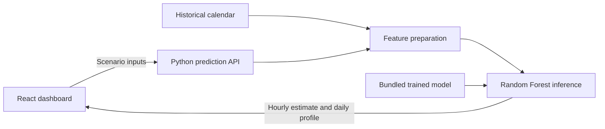

# VeloCast — Bike Demand Intelligence

An interactive machine learning application that estimates hourly bike rental demand from historical calendar and weather conditions.

   

## Overview

VeloCast turns a previously trained Random Forest regression model into an accessible, interactive web application. Users can explore how time of day, seasonal patterns and weather conditions influence estimated bike rental demand through a responsive dashboard.

The application is an inference-focused extension of a university group Data Engineering and MLOps project involving Apache Airflow, MariaDB, Redis and MLflow. It demonstrates how an existing machine learning artefact can be integrated into a standalone web application without rerunning the original training pipeline.

The underlying model uses historical Capital Bikeshare data from Washington, DC, covering 2011–2012. VeloCast is a historical scenario exploration tool, rather than a live demand forecasting service.

## Related Project — MLOps Pipeline

VeloCast is built using a pre-trained Random Forest model originating from an end-to-end Bike Sharing Demand Prediction MLOps project.

The original pipeline incorporates data ingestion, validation, feature engineering, automated model training, experiment tracking and model registration using Apache Airflow, MLflow, MariaDB and Redis.

VeloCast extends this work by providing an accessible, cloud-deployed interface for model inference.

- [Original MLOps Pipeline Repository](https://github.com/Thenul14/bike-sharing-mlops-pipeline)


## Key features

- **Interactive prediction:** Estimate hourly rental demand by selecting a date, hour and weather conditions.
- **24-hour demand profile:** Visualise estimated demand throughout the selected day and identify the predicted peak hour under constant weather conditions.
- **Automated feature preparation:** Derive season, weekday, holiday and working-day information from the historical dataset's calendar.
- **Real model inference:** Generate predictions using the original trained Random Forest model, rather than simulated or hardcoded outputs.
- **Responsive interface:** A lightweight React dashboard with input validation, loading indicators and error handling.
- **Serverless architecture:** A Python prediction API designed for Vercel, with no external inference service, database or API keys required at runtime.

## Machine learning model

The application uses the original Random Forest Regressor from the archived MLflow model registry. The model contains 100 decision trees and accepts 13 calendar and weather features.

| Metric | Original held-out test result |
| :--- | ---: |
| R² | **0.9458** |
| Mean Absolute Error (MAE) | 24.58 rentals |
| Root Mean Squared Error (RMSE) | 41.44 rentals |
| Number of decision trees | 100 |
| Input features | 13 |

These figures are historical results from the original project, not a new evaluation of the deployed application. R² is a regression goodness-of-fit metric, not a classification accuracy percentage.

### Model optimisation for deployment

The original model was compressed losslessly from approximately 119.2 MB to 19.1 MB using gzip, reducing its stored size by about 84% without retraining or altering the underlying model bytes. Prediction-equivalence checks on all 17,379 original hourly dataset rows found identical outputs between the original and compressed model.

The model is loaded on demand and cached by the Python inference function. The original feature ordering and training-scale weather values are preserved to maintain consistency with the training pipeline.

## System architecture



The frontend submits scenario parameters to the same-origin prediction API. The backend validates the inputs, retrieves historical calendar information and constructs the 13-feature input schema. The model evaluates all 24 hours of the selected date, returning both the selected hour's estimate and the complete daily demand profile.

## Technology stack

| Layer | Technologies |
| :--- | :--- |
| Frontend | React, JavaScript, CSS, Vite |
| Backend | Python, HTTP serverless function |
| Machine learning | scikit-learn, Random Forest Regression |
| Data processing | pandas, NumPy |
| Model storage | Losslessly compressed pickle artefact |
| Deployment target | Vercel |
| Testing | Python unittest, reference prediction cases |
| Original training pipeline | Apache Airflow, MariaDB, Redis, MLflow |

## Example prediction

A sample scenario illustrates the application's model inference:

| Input | Value |
| :--- | :--- |
| Date | 15 July 2012 |
| Time | 17:00 |
| Weather | Clear / partly cloudy |
| Temperature | 24°C |
| Feels-like temperature | 26°C |
| Humidity | 65% |
| Wind speed | 12 km/h |
| **Predicted hourly rentals** | **571 bikes** |

The unrounded model output is 570.72 rentals. This is a model-generated estimate for the supplied historical scenario, not an observed rental count.

## API

| Method | Endpoint | Description |
| :--- | :--- | :--- |
| `GET` | `/api/predict` | Lightweight endpoint health check |
| `POST` | `/api/predict` | Predict hourly demand and return the 24-hour profile |

Example request body:

```json
{
  "date": "2012-07-15",
  "hour": 17,
  "weather": 1,
  "temp": 24,
  "atemp": 26,
  "humidity": 65,
  "windspeed": 12
}
```

The API returns the estimated rental count, hourly predictions, calendar context and model information. Invalid scenario inputs are rejected with a descriptive error response.

## Repository structure

```text
velocast-bike-demand/
├── api/                 # Prediction endpoint and feature preparation
├── models/              # Trained model, historical calendar and metadata
├── public/              # Static assets
├── src/
│   ├── components/      # Prediction form, results and hourly chart
│   ├── services/        # Frontend API integration
│   ├── App.jsx
│   └── index.css
├── tests/               # Model integrity and prediction regression tests
├── dev_server.py        # Local development API server
├── requirements.txt     # Python dependencies
├── package.json         # Frontend dependencies
├── vercel.json          # Deployment configuration
└── README.md
```

## Testing and verification

Five automated unit tests passed in the packaging environment, covering model integrity, feature schema, prediction output, 30 reference scenarios and invalid-input handling. The HTTP prediction endpoint was also tested locally.

The verification environment used scikit-learn 1.8.0; the project pins the original training version (1.7.2) for deployment. The Vite production build and cloud deployment have not been independently verified. Reference prediction checks establish consistency, not independent model accuracy.

## Scope and future improvements

VeloCast demonstrates the integration of machine learning, software engineering and model serving in an interactive application. Its estimates are limited to scenarios within the 2011–2012 historical dataset; they do not represent current bike availability or reliable forecasts for other cities or years. The 24-hour profile assumes constant weather, and the application does not estimate prediction uncertainty. The original random train/test split may also overestimate performance on future periods.

Potential extensions include time-based validation, updated mobility datasets, live weather integration and prediction uncertainty estimates.

## Dataset and acknowledgements

- **Dataset:** [Bike Sharing — UCI Machine Learning Repository](https://doi.org/10.24432/C5W894), H. Fanaee-T and J. Gama.
- **Research:** [Event labeling combining ensemble detectors and background knowledge](https://doi.org/10.1007/s13748-013-0040-3).
- **Model provenance:** BikeShare_RandomForest, version 4, from the original university group MLOps project. Model metadata is included in `models/metadata.json`.

The original training pipeline and model were developed as collaborative university coursework. VeloCast is a standalone inference application built around that shared work. No open-source licence is asserted for the group's original work or trained model.
