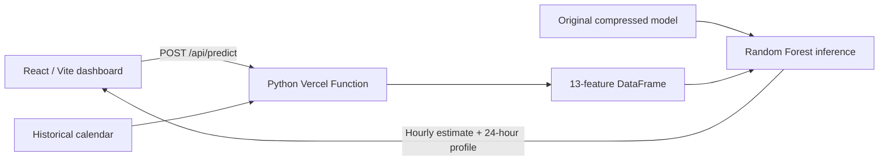

# VeloCast — Bike Demand Intelligence

An interactive machine learning portfolio application for exploring historical hourly bike rental demand. The React dashboard calls a same-origin Python prediction function on Vercel, using the original saved Random Forest from a university group MLOps project.

**No retraining, database, API key, external inference service or MLflow server is required.**

## Features

- Scenario inputs: historical date, hour, weather, temperature, feels-like temperature, humidity and wind speed.
- Automatic calendar features from the original dataset (season, weekday, holiday and working day).
- Actual model prediction, plus a 24-hour profile holding weather constant.
- Responsive light-themed interface, loading and error states, input validation and accessible controls.
- Original model file compressed losslessly; the API loads the bundled model directly.

## Deploy on Vercel

1. Extract this ZIP. Open the `velocast-bike-demand` folder in VS Code. Keep the `models` folder and all hidden configuration files.
2. Create an empty repository at [github.com/new](https://github.com/new) named `velocast-bike-demand`. Keep it private until you have permission to publish the original group work and its model.
3. Run the following commands from the extracted project root (substitute your GitHub username):

   ```bash
   git init
   git add .
   git status
   git commit -m "Deploy VeloCast bike demand prediction demo"
   git branch -M main
   git remote add origin https://github.com/YOUR_USERNAME/velocast-bike-demand.git
   git push -u origin main
   ```

4. Sign in to [Vercel](https://vercel.com/new) with GitHub and import the repository into your personal Hobby account.
5. Keep the root directory as `.`. Framework preset: **Vite**. Node.js: **22.x**. The committed `vercel.json` sets `npm install`, `npm run build`, `dist`, and the Python API's bundled model files. Python 3.12 is specified in `.python-version`.
6. No environment variables are needed. Select **Deploy**. Open the deployment URL and press **Predict demand**. A first request may be slower while the model loads.
7. Confirm the `/api/predict` health URL returns JSON and the prediction POST succeeds. The default example should return approximately **570.72**, displayed as **571 bikes**.

The Hobby plan is intended for personal, non-commercial projects within its quotas. This package is designed for Vercel's Python runtime and a normal Vite frontend; actual cloud deployment was not performed. If a deployment reports a function bundle-size limit, inspect build logs and the current Vercel Python limits before changing plans. Do not remove the model file. See [Python runtime](https://vercel.com/docs/functions/runtimes/python) and [Hobby plan](https://vercel.com/docs/plans/hobby).

## Run locally (Windows / VS Code)

Install Python 3.12 and Node.js 22, then open the extracted folder. In terminal 1 (PowerShell):

```powershell
py -3.12 -m venv .venv
.\.venv\Scripts\python.exe -m pip install -r requirements.txt
.\.venv\Scripts\python.exe dev_server.py
```

Leave the Python server running on port 8000. In a second terminal:

```powershell
npm install
npm run dev
```

Open the URL printed by Vite (usually `http://localhost:5173`). Vite proxies API requests to the local Python server. To build: `npm run build`. To preview the build locally with the API still running: `npm run preview`.

On macOS/Linux, use `python3.12 -m venv .venv`, `.venv/bin/python -m pip install -r requirements.txt`, then `.venv/bin/python dev_server.py` instead.

## Architecture



```text
velocast-bike-demand/
├── api/predict.py                 # Vercel function and input validation
├── models/
│   ├── random_forest.pkl.gz       # Required losslessly compressed model
│   ├── calendar.json              # Calendar fields for the 731 historical dates
│   └── metadata.json              # Original model provenance and metrics
├── public/favicon.svg
├── src/
│   ├── components/               # Form, result, chart and icons
│   ├── services/predictionService.js
│   ├── App.jsx
│   ├── main.jsx
│   └── index.css
├── tests/                         # Reference predictions and unit tests
├── dev_server.py                  # Local HTTP server
├── requirements.txt
├── package.json
├── vite.config.js
├── vercel.json
└── README.md
```

## Model provenance

| Metric | Original archived value |
|---|---:|
| R² (held-out test) | 0.94577154 |
| MAE | 24.58177 rentals |
| RMSE | 41.43871 rentals |
| Trees | 100 |
| Training scikit-learn version | 1.7.2 |

The source is the **BikeShare_RandomForest version 4** model from the archived MLflow experiment `163616190966530924`, model `m-19cbb2382bb545f299a0476d321957a1` and run `d2fc377bc6374b03926e8d6fe2df1e21`. These are historical logged metrics, not newly measured generalisation results. Gzip preserves the exact pickle bytes (SHA-256 in `models/metadata.json`). Only load this trusted bundled model; never unpickle a file from an untrusted source. The original MLOps pipeline is a separate project, and this package does not modify it. Add a link to the pipeline repository and acknowledge all contributors before publishing.

### Input contract

The model expects these columns, in order: `season, yr, mnth, day, hr, holiday, weekday, workingday, weather_situation, temp, atemp, hum, windspeed`.

The original training code converted normalised features using `temp*47-8`, `atemp*66-16`, `hum*100`, `windspeed*67`. The dashboard accepts values directly on those training scales, so it must **not** normalise them a second time. The calendar is derived from the original `day.csv` rather than inferred using modern holiday rules. Date is restricted to 2011–2012. Season labels follow the source dataset's coding. Severe weather is a rare condition in the dataset.

### API example

POST `/api/predict` with `Content-Type: application/json`:

```json
{"date":"2012-07-15","hour":17,"weather":1,"temp":24,"atemp":26,"humidity":65,"windspeed":12}
```

Weather codes: 1 = clear/partly cloudy; 2 = mist/cloudy; 3 = light rain/snow; 4 = severe rain/snow. Response includes `predicted_count`, `hourly` (24 `{hour,count}` objects), calendar `context`, `model`, `date` and `hour`. Invalid inputs return HTTP 400 with an error message. GET `/api/predict` is a lightweight route health check, not a model-inference check.

## Verification

```bash
python -m unittest discover -s tests -v
```

Five tests passed in the packaging environment, including model byte integrity and 30 reference input cases. Original and compressed models produced exactly identical predictions for all 17,379 archived hourly dataset rows. Calendar fields matched the same rows. The packaging environment had Python 3.13 and scikit-learn 1.8.0, not the original pinned 1.7.2. Dependency downloads were blocked, so the Vite production build and tests in the exact deployment environment were not run. The deployment pins scikit-learn 1.7.2 to avoid cross-version deserialisation. Verify both on your computer or Vercel before presenting the live demo. The reference cases are regression checks, not an independent accuracy evaluation.

## Limitations and attribution

- This is a historical scenario simulator, **not a live forecast**, not a real-time bike availability service and not a prediction for another city or current year.
- The original random train/test split may overestimate future-time generalisation; weather is held constant for the daily profile, and no uncertainty interval is claimed.
- Data: Fanaee-T, H. and Gama, J., *Bike Sharing*, UCI Machine Learning Repository. [Dataset DOI](https://doi.org/10.24432/C5W894). Based on Capital Bikeshare in Washington, DC (2011–2012). Related paper: *Event labeling combining ensemble detectors and background knowledge*, Progress in Artificial Intelligence, DOI: [10.1007/s13748-013-0040-3](https://doi.org/10.1007/s13748-013-0040-3).
- The original trained model is group coursework; confirm permission from relevant contributors and university before publishing. No open-source licence is imposed on the group's work by this package.
